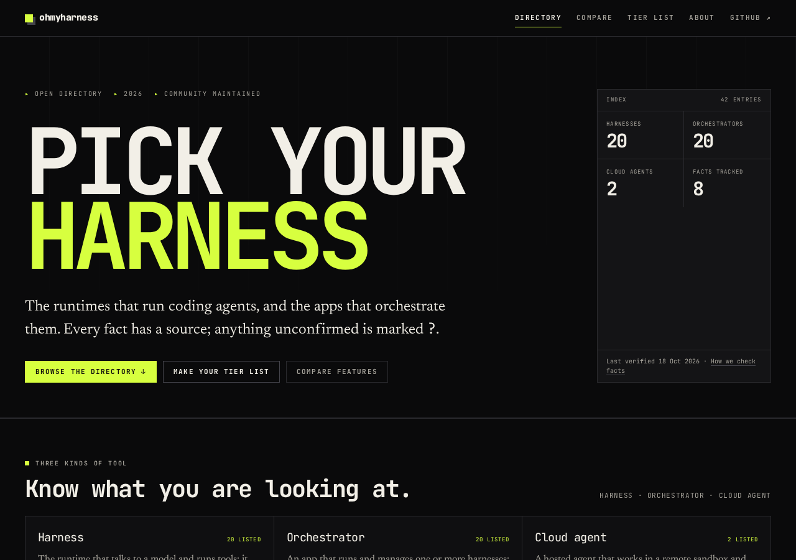

# ohmyharness

An open, sourced directory of AI coding harnesses, orchestrators and cloud
agents. Every entry says what it runs on, how it is priced, and which features
are actually confirmed — with the sources used to check it. If nobody has
verified a fact, it is `null` and shown as **?**, never guessed.

**[ohmyharness.com](https://ohmyharness.com)**



## What is in the directory

- **Harness** — the runtime that talks to a model and runs tools: Claude Code,
  Codex CLI, Aider and similar.
- **Orchestrator** — an app that runs one or more harnesses: T3 Code,
  Conductor, Claude Squad.
- **Cloud agent** — works in a hosted sandbox and hands back a pull request.

The same data powers the directory, a feature matrix, head-to-head pages, tier
lists, [`/api/tools.json`](https://ohmyharness.com/api/tools.json) and
[`/llms.txt`](https://ohmyharness.com/llms.txt).

## Local development

Requires Node.js 22.22 or newer.

```sh
npm ci --ignore-scripts
npm run dev            # http://localhost:4321
```

| Command | What it does |
| --- | --- |
| `npm run dev` | Start the dev server |
| `npm run build` | Build the static site to `dist/` |
| `npm run preview` | Serve the built site |
| `npm run validate` | Check every file in `data/tools/` against the schema |
| `npm run check` | Astro and TypeScript diagnostics |
| `npm run typecheck` | `tsc --noEmit` |
| `npm run verify` | Validate, check, typecheck and build |

Every dependency is pinned to an exact version. Use `npm install --ignore-scripts`
when adding one, and commit the updated `package-lock.json`.

## Add a tool in 3 steps

1. **Check the facts.** Find a source for each field: the tool's website, docs
   or repository. If you cannot confirm something, leave it `null` — do not
   guess.
2. **Add one file.** Copy a file from `data/tools/` to `data/tools/<slug>.json`
   and fill it in. The `slug` must match the filename. The schema is in
   [`src/data/schema.ts`](src/data/schema.ts); the field reference is in
   [`SPEC.md`](SPEC.md).
3. **Open a pull request.** Run `npm run validate` first. CI repeats the check,
   a maintainer reviews the sources, and the entry goes live after merge.

`null` is meaningful: it means *unknown or not verified yet*. A source-confirmed
absence is `false`. See [CONTRIBUTING.md](CONTRIBUTING.md) for the full rules.

## Project layout

```
data/tools/          one JSON file per tool (the data people edit)
src/data/            schema and loader
src/pages/           routes, JSON API, llms.txt, robots.txt
src/components/      Astro components
src/scripts/         vanilla TypeScript islands (filters, compare, tier list)
src/styles/          design system
scripts/validate.ts  standalone data check for CI
tests/fixtures/      small fixtures for testing the loader and build
```

Set `OMH_DATA_DIR` to load a different directory, for example
`OMH_DATA_DIR=tests/fixtures/tools npm run build`. The default is `data/tools/`.
The site builds even when that directory is empty or only partly filled.

## Deploy

The included `Dockerfile` builds the site with Node and serves `dist/` from
nginx as a non-root user on port 8080.

```sh
docker compose up --build
```

The compose file uses `expose: ["8080"]` and publishes no host ports; put a
reverse proxy (Coolify, Traefik, or your own) in front of it. Cache headers and
gzip are in [`nginx.conf`](nginx.conf).

## Contributing

Corrections are as welcome as new entries. Read
[CONTRIBUTING.md](CONTRIBUTING.md), then use the issue templates or open a pull
request. There are no paid rankings, sponsored placements or affiliate links,
and taglines describe what a tool does rather than how good it is.

## Credits

The animated hero headline, the letter field behind it, the directory counts
and the logo marquee are adapted from [React Bits](https://reactbits.dev) by
David Haz, used under the MIT + Commons Clause licence. The upstream licence
notice is kept at
[`src/components/react/reactbits/LICENSE.md`](src/components/react/reactbits/LICENSE.md).
Local adaptations remove the `motion` dependency and keep the final text in
the server-rendered HTML.

## Licence

MIT — see [LICENSE](LICENSE). The data in `data/tools/` is released under the
same licence. A link back is appreciated.

Logos and product names belong to their respective owners and are used to
identify the products.
